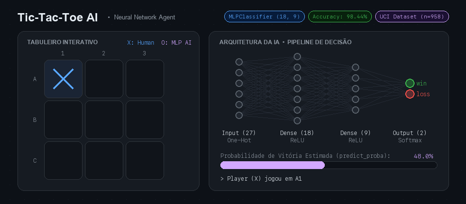

# 🎮 Tic-Tac-Toe AI com Machine Learning (MLPClassifier)

<p align="center">
  
</p>

Um jogo da velha (*Tic-Tac-Toe*) interativo desenvolvido em Python que utiliza uma **Rede Neural Artificial (Multi-Layer Perceptron - `MLPClassifier`)** treinada no clássico dataset *Tic-Tac-Toe Endgame* (UCI Machine Learning Repository) para jogar contra humanos.

---

## 📋 Sobre o Projeto

O objetivo deste projeto é aplicar conceitos fundamentais de **Aprendizado de Máquina Supervisionado** em um ambiente prático de jogo. Em vez de usar algoritmos tradicionais de busca em árvore (como *Minimax*), o agente inteligente avalia o estado do tabuleiro através de um modelo de classificação probabilística:

1. **Pré-processamento de Dados**:
   - Leitura da base `tic-tac-toe.data` com 958 configurações finais possíveis de tabuleiros.
   - Codificação de variáveis categóricas (*One-Hot Encoding* via `pd.get_dummies`).
   - Divisão treino/teste (80% / 20%) e normalização com `StandardScaler`.
2. **Treinamento do Modelo**:
   - Rede Neural **MLP (`MLPClassifier`)** com duas camadas ocultas `(18, 9)` e até `2000` iterações.
   - Atinge **98.44% de acurácia** no conjunto de teste.
3. **Tomada de Decisão da IA (`get_ai_move`)**:
   - A cada turno da IA, todas as casas vazias são simuladas.
   - Caso a IA esteja jogando como `O`, os símbolos do tabuleiro são espelhados na consulta para que o modelo avalie a probabilidade da configuração ser vitoriosa (`positive`) sob a perspectiva da IA.
   - A jogada que maximiza `predict_proba` para a classe `positive` é escolhida.

---

## 📂 Estrutura do Repositório

```text
ml-tictactoe/
├── assets/
│   └── banner.gif            # Animação de demonstração da IA e arquitetura MLP
├── tic_tac_toe/              # Pacote com a lógica e motor do jogo no terminal
│   ├── __init__.py
│   ├── constants.py          # Constantes do tabuleiro, mapeamento A1-C3 e combinações de vitória
│   ├── run.py                # Loop principal do jogo (Player vs Player / Player vs AI)
│   └── tic_tac_toe.py        # Funções de exibição do tabuleiro, validação de jogadas e checagem de vencedor
├── tic-tac-toe.data          # Dataset UCI Tic-Tac-Toe Endgame (958 instâncias)
├── tic-tac-toe.names         # Documentação oficial e metadados do dataset
├── tic_tac_toe_p1.ipynb      # Notebook principal: pipeline de ML + execução do jogo contra a IA
├── requirements.txt          # Dependências do projeto
└── README.md                 # Documentação do projeto
```

---

## 🚀 Como Executar

### 1. Clonar o repositório

```bash
git clone https://github.com/SEU-USUARIO/ml-tictactoe.git
cd ml-tictactoe
```

### 2. Instalar as dependências

Recomenda-se o uso de um ambiente virtual (`venv`):

```bash
python3 -m venv .venv
source .venv/bin/activate  # No Windows: .venv\Scripts\activate
pip install -r requirements.txt
```

### 3. Executar o Notebook

Abra o arquivo `tic_tac_toe_p1.ipynb` no **Jupyter Notebook**, **JupyterLab**, **VS Code** ou **Google Colab** e execute as células em sequência:

```bash
jupyter notebook tic_tac_toe_p1.ipynb
```

---

## 🕹️ Exemplo de Partida

Ao executar a última célula (`run.runGame(get_ai_move)`), você pode escolher entre **Player vs Player (1)** ou **Player vs AI (2)** e informar as coordenadas no formato `LinhaColuna` (`A1`, `B2`, `C3`, etc.):

```text
Welcome to Tic Tac Toe!
Choose game mode:
1. Player vs Player
2. Player vs AI
Enter 1 or 2: 2
Your Player 2 is our implemented AI.

   1   2   3
A  X |   | O
  ---+---+---
B    | X |  
  ---+---+---
C    |   |  
```

---

## 📊Sobre o Dataset (UCI Machine Learning Repository)

- **Título**: *Tic-Tac-Toe Endgame Database*
- **Autor / Doador**: David W. Aha (1991)
- **Instâncias**: 958 configurações legais de fim de jogo
- **Atributos**: 9 posições do tabuleiro (`x`, `o`, `b` para vazio) + atributo alvo `Class` (`positive` ou `negative` para vitória de `x`)

---

## 🛠️ Tecnologias Utilizadas

- **Python 3**
- **Pandas & NumPy** — Manipulação de dados e codificação de atributos
- **Scikit-Learn** — `MLPClassifier`, `StandardScaler`, `train_test_split`, `accuracy_score`
- **Jupyter Notebook** — Ambiente interativo de experimentação e execução

